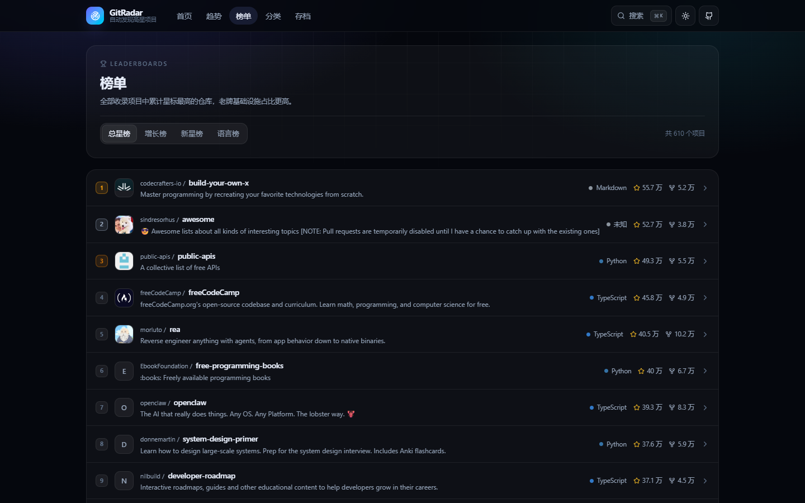
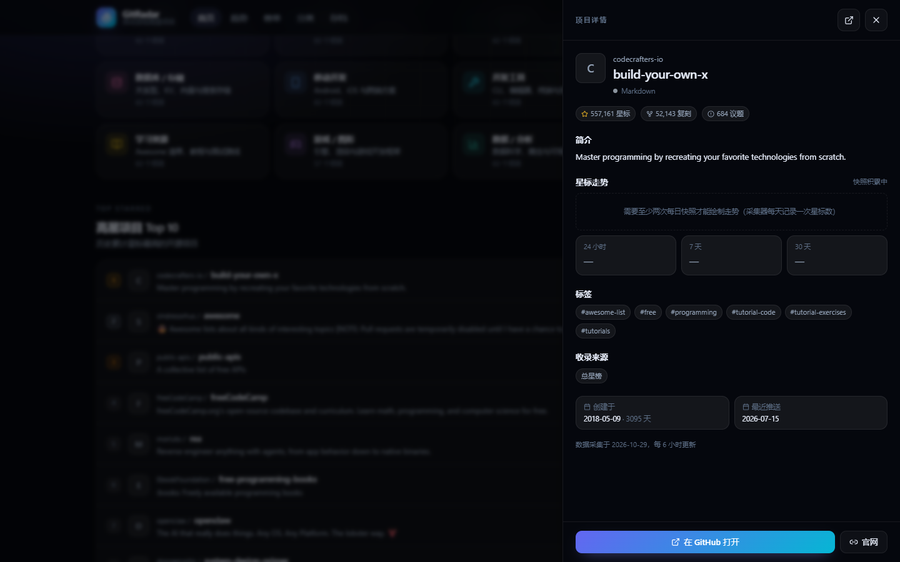

<div align="center">

# GitRadar · 星探

**自动发现 GitHub 高星项目的中文趋势雷达**

[](https://github.com/Anti-Anti-Anit/gitradar/actions/workflows/deploy.yml)
[](https://github.com/Anti-Anti-Anit/gitradar/actions/workflows/collect.yml)
[](LICENSE)
[](https://react.dev)
[](https://vite.dev)

**在线使用 → https://anti-anti-anit.github.io/gitradar/**

*纯静态站点 · 零服务器 · GitHub Actions 每 6 小时自动采集与部署*

</div>

---

## 这是什么

GitHub 上的项目太多，Trending 只看 25 个、按星标排序又全是被反复介绍的老项目。GitRadar 把「发现高星项目」拆成几个不同视角，并把数据全自动更新：

- **趋势榜**：直接解析 GitHub Trending 页面（日 / 周 / 月），标注窗口内新增星标
- **榜单**：总星榜、**7 日增长榜**、新星榜（近 180 天创建）、语言榜
- **分类**：12 个中文主题分类（AI、前端、后端、云原生、数据库、移动、工具、安全、学习、游戏、数据、效率）
- **增长曲线**：每天记录一次星标快照，自动计算 24 小时 / 7 天 / 30 天增量并绘制 sparkline
- **全局搜索**：`Ctrl / Cmd + K` 搜索项目、标签、语言，键盘上下选择
- **趋势存档**：把每天的 Trending 榜单存档 90 天，可回看某项目是哪天被社区发现的
- **中文体验**：全中文界面、深色 / 浅色主题、移动端适配；可选 AI 生成中文简介

## 界面预览

<p align="center">
  
  
</p>
<p align="center">
  
</p>

## 数据流水线

```
┌──────────────────────────────────────────────────────────────┐
│ GitHub Actions（每 6 小时 / 手动触发）                        │
│                                                              │
│  github.com/trending ──► 页面解析 ──┐                        │
│  Search API ──► 总星榜/新星榜/分类 ──┼──► 去重聚合 477+ 项目  │
│  /repos/{owner}/{repo} ──► 趋势补全 ─┤                        │
│  历史快照 ──► 24h/7d/30d 增长 ──────┘                        │
│                          │                                   │
│                          ▼                                   │
│   public/data/*.json（前端数据源）+ data/snapshots/（快照）    │
│                          │                                   │
│                git commit && push ──► 触发 Deploy workflow    │
└──────────────────────────┬───────────────────────────────────┘
                           ▼
        React + Vite 静态构建 ──► GitHub Pages
```

采集在 GitHub 的 runner 上执行，因此 **Trending 页面与 API 都能直连**，本地无需任何代理。Trending 抓取失败时会自动回退到上一次的榜单，不会把站点写坏。

## 榜单口径

| 榜单 | 规则 |
| --- | --- |
| 总星榜 | 收录池内按 `stargazers_count` 降序 |
| 增长榜 | 与最近一次 ≥7 天前的快照对比的星标增量（不足 7 天则用 24 小时数据） |
| 新星榜 | `created_at` 在近 180 天内、星标 ≥300，按星标排序 |
| 趋势榜 | GitHub Trending 页面窗口（daily / weekly / monthly）内的新增星标 |
| 分类 | GitHub `topic:` 搜索结果为种子，再用仓库 topics 补充，均按星标排序 |

> 星标只代表热度，不代表质量。增长率在站点首次上线后需要积累 1~7 天才会出现数据。

## 本地运行

```bash
# 1. 安装依赖
npm install

# 2. 采集数据（需要一个 GitHub token，任选其一）
export GITHUB_TOKEN=$(gh auth token)   # 或者填自己的 PAT
npm run collect

# 3. 启动前端
npm run dev        # http://localhost:5173
npm run build      # 产物在 dist/
```

数据采集会写入：

```
public/data/repos.json       收录池（约 500 个项目，含增长与走势）
public/data/trending.json    日/周/月趋势
public/data/categories.json  12 个分类的项目索引
public/data/languages.json   语言分布
public/data/meta.json        采集元信息
public/data/history/*.json   每日趋势存档（最多 90 天）
data/snapshots/*.json        每日星标快照（用于计算增长）
data/ai-cache.json           AI 中文简介缓存
```

## 部署自己的实例

1. Fork 本仓库（或直接作为模板）。
2. 仓库 **Settings → Pages → Source** 选择 **GitHub Actions**。
3. 进入 **Actions → Collect data → Run workflow** 采集首批数据（约 2 分钟）。
4. 之后每 6 小时自动采集并部署，站点地址为 `https://<你的用户名>.github.io/<仓库名>/`。

### 可选配置

| 名称 | 类型 | 说明 |
| --- | --- | --- |
| `GITHUB_TOKEN` | 内置 secret | Actions 自动注入，无需配置 |
| `OPENAI_API_KEY` | secret | 可选。配置后自动为项目生成中文简介（带缓存，每次最多 150 条） |
| `OPENAI_BASE_URL` | variable | 可选，兼容 OpenAI 协议的服务地址，默认 `https://api.openai.com/v1` |
| `AI_MODEL` | variable | 可选，默认 `gpt-4o-mini` |

不配置 AI 时站点照常工作，只是简介保留英文原文。

## 技术栈

- **前端**：React 19 + TypeScript + Vite 7 + Tailwind CSS 4，无运行时后端
- **采集器**：Node.js ESM 脚本 + Cheerio，GitHub REST API（Search + Repos）
- **部署**：GitHub Actions + GitHub Pages，数据变更自动触发重新构建

一次采集约消耗 **18~80 次 API 请求**（Search API 有 30 次/分钟限制，脚本已内置节流与退避重试）。

## Roadmap

- [ ] AI 摘要支持更多语言与自定义提示词
- [ ] 按周/月的分类增长榜
- [ ] 项目对比与收藏（纯前端 localStorage）
- [ ] RSS / Atom 订阅

## 免责声明

本站数据来自 GitHub 公开 API 与 Trending 页面，版权归各开源项目作者所有。Trending 页面没有官方 API，页面结构变化可能导致抓取失败，采集器已做容错与回退处理。

## License

[MIT](LICENSE) © 2026 Anti-Anti-Anit
